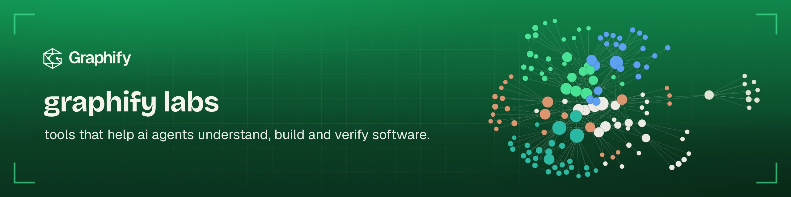
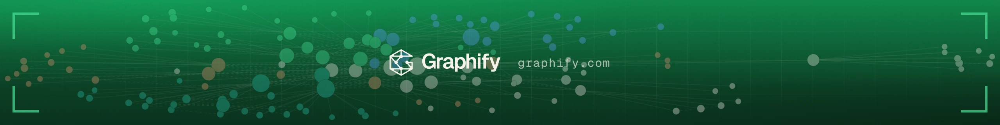

<p align="center">
  <a href="https://app.graphify.com/org-site"></a>
</p>

<p align="center"><b>Give your AI agents a map of your codebase, then check the code they write.</b></p>

<p align="center">
  <a href="https://github.com/Graphify-Labs/graphify"></a>
  <a href="https://pepy.tech/project/graphifyy"></a>
  <a href="https://www.ycombinator.com/companies/graphify-labs"></a>
  <a href="https://app.graphify.com/org-discord"></a>
</p>

<table>
<tr>
<td width="50%" valign="top">

### Understand
[**graphify**](https://github.com/Graphify-Labs/graphify) turns your code, docs, SQL schemas and configs into one knowledge graph your agent can query: who calls what, what a change touches, how A reaches B. Local AST parsing, every edge explained. Free and open source.

</td>
<td width="50%" valign="top">

### Give agents context
The [**Graphify MCP server**](https://app.graphify.com/org-mcp) and **Graphify Cloud** hand your agent the exact part of the graph it needs, across all your repos. Works with Claude Code, Cursor, Codex, OpenCode, Gemini CLI and any MCP client.

</td>
</tr>
<tr>
<td width="50%" valign="top">

### Review
Graphify Cloud reviews your pull requests with the graph behind them, so findings point to real callers, blast radius and file:line, not guesses.

</td>
<td width="50%" valign="top">

### Verify
Graphify Cloud runs differential formal verification on pull requests: it compares the old and new code and shows what behaviour actually changed. [**REAgraph**](https://github.com/Graphify-Labs/REAgraph) is our open-source graph memory and structural diff for reverse engineering.

</td>
</tr>
</table>

### Get started in 30 seconds

```bash
uv tool install graphifyy   # or: pipx install graphifyy
graphify install            # detects your assistant and registers the skill
```

Then ask your agent about your codebase, or connect your repos to [**Graphify Cloud**](https://app.graphify.com/org-trial-cta) for PR review, verification and team-wide context.

<p align="center">
  <a href="https://app.graphify.com/org-trial-cta"><b>Try Graphify Cloud free →</b></a> ·
  <a href="https://github.com/Graphify-Labs/graphify">graphify on GitHub</a> ·
  <a href="https://app.graphify.com/org-docs">Docs</a> ·
  <a href="https://app.graphify.com/org-discord">Discord</a> ·
  <a href="https://app.graphify.com/org-x">X</a> ·
  <a href="https://app.graphify.com/org-youtube">YouTube</a>
</p>

<p align="center"></p>
